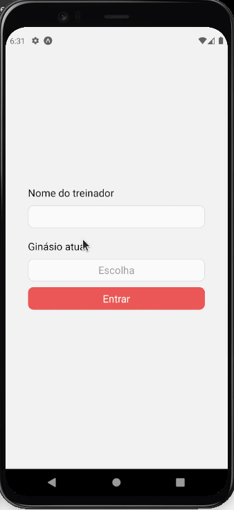

# Project
This project is an UI/UX design for Arlley Gomes. Using [PokeApi v2](https://pokeapi.co/docs/v2).

## 🚀 Techs
- [Expo SDK 58](https://expo.dev/) + [React Native](https://reactnative.dev/) + [TypeScript](https://www.typescriptlang.org/)
- [React Navigation 7](https://reactnavigation.org/) (native stack + bottom tabs)
- [TanStack Query](https://tanstack.com/query) for PokeAPI requests and caching
- [Styled Components](https://styled-components.com/)
- [expo-image](https://docs.expo.dev/versions/latest/sdk/image/) and [Lottie](https://docs.expo.dev/versions/latest/sdk/lottie/)

## ▶️ Running
```
pnpm install
pnpm start
```
Scan the QR code with Expo Go. Your Expo CLI login must match the account signed in to Expo Go.

# First demonstration
<div align="center">
    
</div>

# Layout
You can see layout [here](https://www.behance.net/gallery/95262057/POKEDEX).

